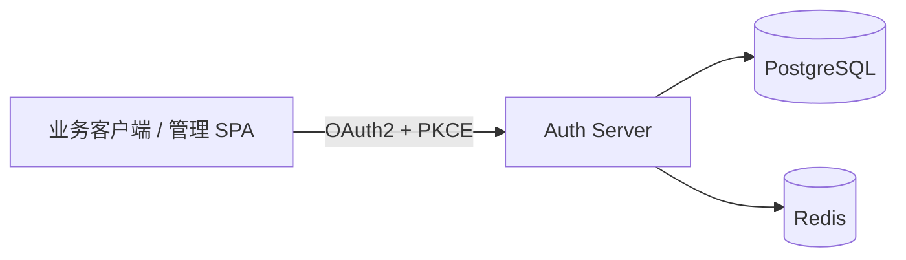

# Auth Server

基于 Go 的 OAuth2 授权服务器，提供用户认证、客户端管理和独立的 React 管理控制台。

[配置与运行](docs/SETUP.md) · [API 概览](docs/API.md) · [管理前端](auth-server-webui/README.md) · [测试](test/README.md) · [路线图](ROADMAP.md)

## 功能

- **OAuth2**：授权码 + S256 PKCE、Refresh Token、机密客户端凭据；支持公共与机密客户端、精确回调匹配和 Scope 限制。
- **用户认证**：邮箱密码与 Telegram 登录，Telegram 自助注册，Turnstile 验证，Argon2id 密码哈希。
- **管理控制台**：用户、客户端、管理员管理，分页查询、启停、密码及客户端 secret 重置。
- **令牌与会话**：JWT / opaque Access Token、刷新轮换、重放检测、用户级强制下线和服务端全局退出。
- **管理权限**：独立管理客户端、管理 Scope 签发校验、实时管理员资格检查和近期认证要求。
- **部署与测试**：Go 嵌入管理 SPA、Docker 多阶段构建、单元测试、安全回归及浏览器集成测试。

当前提供 Discovery、JWKS、Introspection 和 UserInfo；尚不支持完整 OIDC，UserInfo 仅返回 `sub`。会话管理支持用户级撤销，尚无单会话管理。外部资源服务的令牌校验边界见 [API 文档](docs/API.md#令牌与权限)。

## 技术栈与结构

后端使用 Go、Gin、PostgreSQL 和 Redis；管理前端位于 [auth-server-webui/](auth-server-webui/)，使用 React、TypeScript、Vite、Tailwind CSS 和 daisyUI。



| 目录 | 职责 |
|---|---|
| `internal/oauth2/` | 授权、令牌签发、刷新和撤销校验 |
| `internal/http/` | 登录页面、OAuth2 端点和管理 API |
| `internal/store/` | 数据访问与管理权限策略 |
| `auth-server-webui/` | `/admin-page/` 管理控制台 |
| `db/`、`template/`、`assets/` | 数据库结构、登录模板和公共资源 |
| `test/` | 安全、真实服务与浏览器回归 |

## 快速开始

需要 Go 1.26+、Node.js 22.12+、pnpm 11.3.0、PostgreSQL、Redis 和 Turnstile 配置。

先按 [运行指南](docs/SETUP.md) 创建 `config.yaml`、初始化数据库并创建首位管理员，然后从项目根目录启动后端：

```bash
go mod download
OAUTH_ISSUER=http://localhost:5173 go run .
```

另开终端启动管理前端：

```bash
pnpm --dir auth-server-webui install --frozen-lockfile
pnpm --dir auth-server-webui dev
```

访问 `http://localhost:5173/admin-page/`。后端默认监听 `8080`，开发代理由 Vite 提供。服务端读取当前目录的 `config.yaml`，不会自动加载 `.env`。

## 构建与部署

```bash
pnpm --dir auth-server-webui build
go build -tags embedspa -o auth-server .
OAUTH_ISSUER=http://localhost:8080 ./auth-server
```

`embedspa` 仅嵌入管理 SPA；运行时仍需配置、登录模板和公共资源。[Dockerfile](Dockerfile) 自动完成前端和后端构建。HTTPS、持久密钥及容器配置见 [部署指南](docs/SETUP.md#部署)。

## 测试

```bash
go test -race ./...
python3 test/securityaudit/run.py
```

真实 PostgreSQL/Redis 与浏览器测试见 [测试指南](test/README.md)。CI 包含 Go race/vet、安全回归、前端 lint/build、依赖检查和独立服务集成测试。

## License

[MIT](LICENSE.txt)
